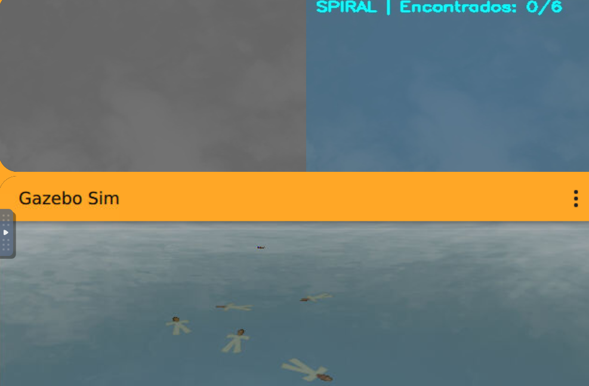

# Autonomous Drone Challenge: Rescue People

**Course ID / Project:** SJK001-7

## Prerequisites and Setup

Before executing the solution, several setup steps were required to configure the development environment:

1. **Unibotics Account:** Created an account on [Unibotics](https://unibotics.org), the platform hosting the virtual robotics simulation environment (JdeRobot Robotics Academy).

2. **Browser Permissions:** Following the course instructions, configured Google Chrome to **allow insecure content** for `unibotics.org`. This permission is required for the web interface to display the Docker container's console and the simulation viewer.

### Running the Docker Backend

On a personal computer, the simulation environment can be deployed locally using the official JdeRobot Docker backend image.

Pull the latest robotics backend image:

```bash
docker pull jderobot/robotics-backend:latest
```

Launch the container and expose the necessary ports for the web GUI and simulation communication (CPU-only):

```bash
docker run --rm -it -p 6080-6090:6080-6090 -p 7163:7163 jderobot/robotics-backend:latest
```

Alternatively, launch the container with hardware graphic acceleration enabled:

```bash
docker run --rm -it --device /dev/dri \
  -p 6080-6090:6080-6090 -p 7163:7163 jderobot/robotics-backend:latest
```

## Problem Overview

The goal of this practice is to implement the autonomous navigation and perception logic that allows a quadrotor to search for, recognize the faces of, and save the locations of lost survivors at sea in order to enable a subsequent rescue maneuver.



*Figure 1: Virtual simulation environment in JdeRobot Robotics Academy showing the dual WebGUI camera panels (top) and the Gazebo Sim marine scenario with the floating survivors (bottom).*

### Operational Context & Requirements

* **Reference Coordinates:** The drone takes off from a safety boat located at `40°16'48.2" N, 3°49'03.5" W`, while the survivors are known to be in the vicinity of `40°16'47.23" N, 3°49'01.78" W`.

* **Execution Feedback:** The program must output descriptive status messages in the terminal throughout execution so the operator can monitor the drone's current state (takeoff, transit, spiral search, victim detection, and return/landing) at any given moment.

* **Final Output:** Upon completing the search, the system must display a clean, deduplicated list of the detected victims' locations in understandable coordinates.

## Solution Overview

To achieve the mission objectives, the autonomous system was structured around four core stages:

1. **Coordinate Frame Transformation (GPS** $\rightarrow$ **Local ENU):** Since the drone control API operates in local metric coordinates relative to its takeoff point (East $+X$, North $+Y$, Up $+Z$) rather than global GPS coordinates, both the safety boat and target search coordinates are converted into a local tangent-plane metric frame to compute the exact relative displacement vector to the search zone.

2. **Systematic Area Coverage (Archimedean Spiral):** Once positioned at the estimated midpoint of the survivors' area, the drone executes a tight outward Archimedean spiral trajectory ($r = a + b\theta$) using position commands (`set_cmd_pos`) with small angular increments to guarantee thorough visual coverage without gaps.

3. **Computer Vision & Face Detection:** Images captured from the drone's ventral camera are processed in real time using OpenCV's Haar Cascade classifier (`haarcascade_frontalface_default.xml`). Because survivors floating in the water may appear at arbitrary orientations relative to the drone's heading, frames are evaluated across multiple rotation angles, and visual bounding boxes are streamed to the WebGUI for live debugging.

4. **Ground Projection, Deduplication & Reporting:** Whenever a face is detected, its pixel offset is projected onto the water surface to obtain its physical coordinate and filtered against previously saved positions to avoid duplicate entries for the same person. Finally, the list of rescued coordinates is printed to the terminal.

### Documentation Structure

For this project, two different communication architectures are implemented and documented separately:

* [**HAL-Based Implementation**](./hal_implementation.md)**:** Solution built on top of JdeRobot's Hardware Abstraction Layer (`HAL` and `WebGUI` APIs), detailing the kinematic spiral equations, coordinate conversion math, and vision pipeline.

* [**ROS 2-Direct Implementation**](./ros2_implementation.md)**:** Solution communicating directly with the Aerostack2 simulation stack via native ROS 2 topics, services, and `rclpy` execution loops.
