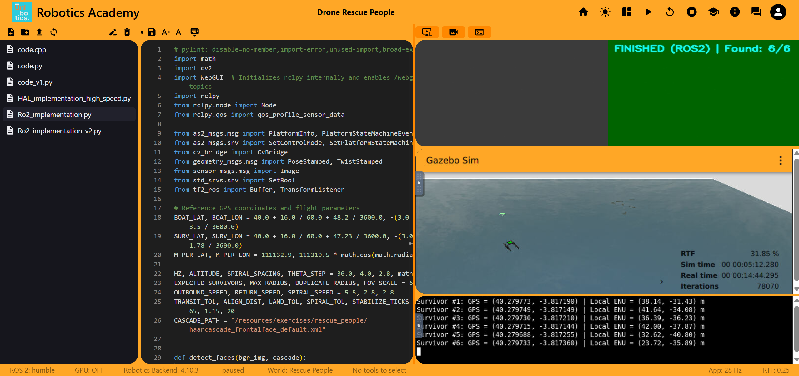
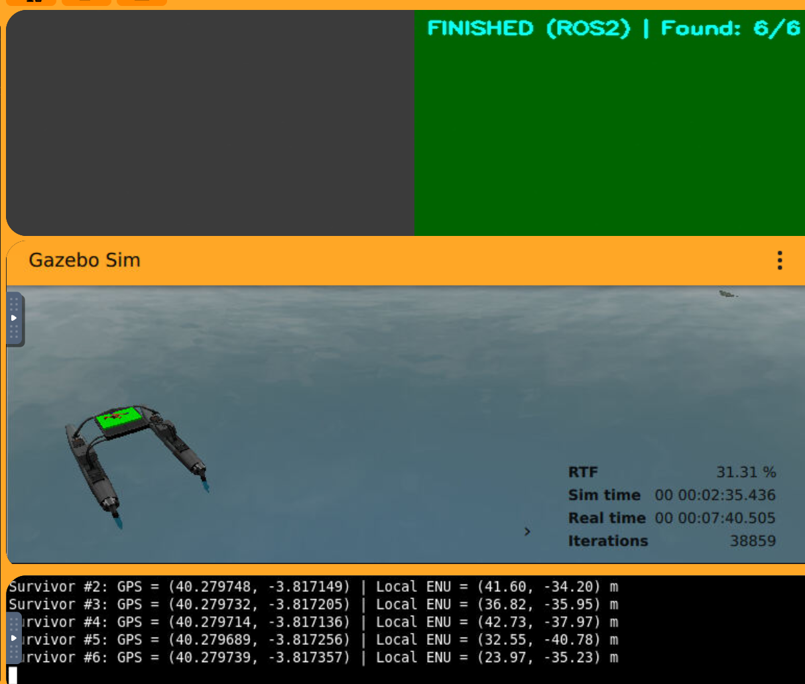

# Direct ROS 2 Implementation (Aerostack2): Rescue People

This document describes the direct **ROS 2 (`rclpy`)** solution for the **Rescue People** autonomous drone mission. Rather than relying on JdeRobot's `HAL` abstraction wrapper, this implementation communicates directly with the **Aerostack2** simulation interfaces under the `/drone` namespace, following the official ROS 2 guidelines from the [JdeRobot Robotics Academy Rescue People documentation](https://jderobot.github.io/RoboticsAcademy/exercises/Drones/rescue_people).

## 1. How the Code Works (Simple Overview)

To keep the architecture straightforward and reliable, the entire mission runs inside a single ROS 2 node (`RescuePeopleDirectNode`) driven by a $30\text{ Hz}$ timer (`control_loop`). As noted in the official documentation, importing `WebGUI` initializes `rclpy` internally and bridges the debug image topics to the browser panels.

Instead of high-level `HAL` calls, the node interacts directly with standard ROS 2 topics, services, and `TF2` transforms:

| Task | ROS 2 / Aerostack2 Interface | Message / Service Type | Purpose |
| :--- | :--- | :--- | :--- |
| **Read Drone Position** | `/drone/self_localization/pose` & `/tf` fallback | `PoseStamped` / `tf2_ros` | Reads local ENU coordinates $(X_c, Y_c, Z_c)$ and heading $\psi$ at $30\text{ Hz}$. |
| **Monitor Velocity** | `/drone/self_localization/twist` | `geometry_msgs/msg/TwistStamped` | Monitors vertical velocity telemetry from the state estimator. |
| **Arm & Takeoff / Land** | `/drone/set_arming_state`, `/drone/set_offboard_mode`, `/drone/platform/state_machine_event` | `SetBool` / `SetPlatformStateMachineEvent` | Arms motors, enables offboard mode, and triggers `ARM`, `TAKE_OFF`, `TOOK_OFF`, `LAND`, and `LANDED`. |
| **Switch Control Mode** | `/drone/controller/set_control_mode` | `SetControlMode` | Toggles Aerostack2 between `POSITION` mode (takeoff & landing) and `SPEED` mode (transit & spiral). |
| **Move by Position** | `/drone/motion_reference/pose` | `geometry_msgs/msg/PoseStamped` | Holds a fixed target coordinate during takeoff, boat alignment, and final touchdown. |
| **Move by Velocity** | `/drone/motion_reference/twist` | `geometry_msgs/msg/TwistStamped` | Commands smooth ENU velocities during transit and the outward spiral search. |
| **Platform Status** | `/drone/platform/info` | `as2_msgs/msg/PlatformInfo` | Verifies arming, offboard status, active control mode, and flight state. |
| **Ventral Camera** | `/drone/ventral_cam/image_raw` | `sensor_msgs/msg/Image` | Converts downward camera frames to OpenCV BGR images via `CvBridge`. |
| **WebGUI Panels** | `/webgui/image_debug_right` & `/webgui/image_debug_left` | `sensor_msgs/msg/Image` | Streams the annotated color feed (right) and processed grayscale feed (left) to the browser. |

## 2. Evolution from the Compact Prototype (`v1` $\rightarrow$ `v2`)

The final solution (`v2`) was built by evolving an initial compact (~215-line) ROS 2 prototype (`v1`) into a cleaner, faster, and more resilient implementation:

* **Dual Localization Pipeline (`/drone/self_localization/pose` + `TF2` Fallback):** The `v1` prototype relied solely on `TF2` lookups with three hardcoded frame pairs. The final `v2` version subscribes directly to `/drone/self_localization/pose` and `/drone/self_localization/twist` as primary localization sources, while keeping a continuous four-pair `TF2` lookup (`read_tf_pose`) as an automatic fallback whenever the pose topic is inactive.
* **Modular Helper Functions & Explicit Constants:** Inline one-liners, chained ternary operators, and hardcoded magic numbers (such as `2, 1, 1` for controller modes) were replaced with dedicated helper functions (`quaternion_to_yaw`, `rotate_img`, `dist_2d`, `compute_enu_twist`), clean service wrappers (`call_set_bool`, `call_sm_event`, `set_controller_mode`), and explicit `ControlMode` attributes.
* **Generalized Yaw Quaternion Computation in `publish_pose()`:** Unlike `v1`—which hardcoded `orientation.w = 1.0`—`publish_pose()` computes the exact quaternion components ($q_z = \sin(\psi / 2)$, $q_w = \cos(\psi / 2)$) for any target heading $\psi$. Combined with lower-latency pose updates from `/drone/self_localization/pose`, this prevents hover oscillation during `ALIGN_BOAT` and cuts overall mission time nearly in half.
* **Synchronized Console & ROS 2 Logging (`log()`):** A unified `log()` method outputs status messages simultaneously to `stdout` (visible in the Unibotics web console) and `/rosout`, reporting every mission milestone (`[INIT]`, `[NAV]`, `[SEARCH]`, `[DETECTION]`, `[RETURN]`, `[ALIGN]`, `[LAND]`) alongside periodic position updates.

## 3. Step-by-Step Mission Flow

Inside the $30\text{ Hz}$ control loop (`control_loop`), the drone updates its localization, processes the latest ventral image, and progresses through an **8-state machine**:

1. **`WAIT_CONNECTION`:** Waits for `/drone/platform/info` and pose localization (`pose` topic or `TF2`), records the boat deck starting position $(X_{\text{start}}, Y_{\text{start}}, Z_{\text{start}})$, and computes the search zone center $(X_{\text{center}}, Y_{\text{center}})$.
2. **`TAKEOFF`:** Arms the drone, enables offboard mode, and sends `ARM` $\rightarrow$ `TAKE_OFF` $\rightarrow$ `TOOK_OFF` events while climbing to $4.0\text{ m}$ above the boat deck.
3. **`GO_TO_ZONE`:** Switches to velocity control (`SPEED` in `LOCAL_ENU_FRAME`) and flies toward the search center at $5.5\text{ m/s}$, braking smoothly on arrival.
4. **`SPIRAL`:** Sweeps the water along an outward **Archimedean Spiral** ($2.8\text{ m}$ loop spacing, starting at $\theta_0 = 180^\circ$) at a steady $2.8\text{ m/s}$. Each frame is evaluated with OpenCV's Haar Cascade across $8$ angles ($0^\circ, 90^\circ, 180^\circ, 270^\circ, 45^\circ, 135^\circ, 225^\circ, 315^\circ$).
5. **`RETURN`:** Once all $6$ survivors are found (or radius $> 20.0\text{ m}$), flies back toward $(X_{\text{start}}, Y_{\text{start}})$ at $2.8\text{ m/s}$, decelerating early to prevent overshooting the boat.
6. **`ALIGN_BOAT`:** Within $3.0\text{ m}$ of the boat, switches back to `POSITION` control and holds $(X_{\text{start}}, Y_{\text{start}})$ until centered within $0.65\text{ m}$ for $\approx 0.67\text{ s}$ ($20\text{ ticks}$).
7. **`LANDING`:** Sends the `LAND` event while commanding a vertical descent onto the deck ($Z_{\text{start}} - 0.10\text{ m}$). Upon touchdown ($Z_c \le Z_{\text{start}} + 0.20\text{ m}$), sends `LANDED` and disarms the motors.
8. **`FINISHED`:** Prints the final rescue report with the GPS and local ENU coordinates of all $6$ survivors.

## 4. Coordinate Conversions & Camera Projection

### GPS to Local ENU Coordinates

Using local flat-earth scale factors at the safety boat's latitude ($M_{\text{lat}} = 111\,132.9\text{ m/deg}$ and $M_{\text{lon}} = 111\,319.5 \cdot \cos(\text{lat}_{\text{boat}})\text{ m/deg}$), the survivors' GPS target is converted into local meters relative to the boat:

$$
X_{\text{center}} = X_{\text{start}} + (\text{lon}_{\text{surv}} - \text{lon}_{\text{boat}}) \cdot M_{\text{lon}}, \qquad Y_{\text{center}} = Y_{\text{start}} + (\text{lat}_{\text{surv}} - \text{lat}_{\text{boat}}) \cdot M_{\text{lat}}
$$

### Orientation & Survivor Ground Projection

The drone's yaw angle $\psi$ is extracted from its orientation quaternion $(q_x, q_y, q_z, q_w)$:

$$
\psi = \text{atan2}\big(2(q_w q_z + q_x q_y),\; 1 - 2(q_y^2 + q_z^2)\big)
$$

When a face is detected within the central $84\%$ of the ventral frame, its unrotated pixel offset $(\Delta u, \Delta v)$ from the image center is projected onto the water surface using the calibrated field-of-view scale $s_{\text{FOV}} = 1.65$:

$$
s_{\text{px}} = \frac{\max(Z_c, 1.0) \cdot s_{\text{FOV}}}{W_{\text{img}}}
$$

$$
X_{\text{face}} = X_c - \Delta v \cdot s_{\text{px}}, \qquad Y_{\text{face}} = Y_c - \Delta u \cdot s_{\text{px}}
$$

Detections separated by at least `DUPLICATE_RADIUS = 3.2 m` from previously recorded victims are stored and converted back to GPS coordinates.

## 5. Simulation Results & Visual Comparison

Both versions locate **6/6 unique survivors** with consistent GPS/ENU coordinates, while `v2` cuts mission duration nearly in half and achieves a dead-center touchdown on the safety boat's deck:

| Metric | ROS 2 Compact Prototype (`v1`) | ROS 2 Final Implementation (`v2`) |
| :--- | :--- | :--- |
| **Survivors Detected** | `6 / 6` (zero duplicates) | `6 / 6` (zero duplicates) |
| **Simulated Flight Time** | `05 min 12.28 s` (`78,070` iterations) | `02 min 35.44 s` (`38,859` iterations) |
| **Wall-Clock Time** | `14 min 44.30 s` (@ `31.85 %` RTF) | `07 min 40.51 s` (@ `31.31 %` RTF) |
| **Touchdown Precision** | Lands slightly beside the boat hull | Lands centered on the boat's green deck |

### Version 1 (`v1` Compact Prototype Execution)

In `v1`, the drone locates all $6$ survivors in $5\text{ min } 12\text{ s}$ of simulated time ($14\text{ min } 44\text{ s}$ real time at $31.85\%$ RTF), touching down in the water just next to the safety boat:

### Version 2 (`v2` Final Implementation Execution)

In `v2`, the improved localization and quaternion-aligned `ALIGN_BOAT` handoff complete the entire mission in **$2\text{ min } 35\text{ s}$ of simulated time** ($7\text{ min } 40\text{ s}$ real time at $31.31\%$ RTF) and land the drone squarely on the center of the boat's landing pad:

* **Full Execution Video (Best Time - ROS 2 `v2`):** [Watch Mission Recording on Google Drive](https://drive.google.com/file/d/14fDceg9GdwtGD1c1nAIPiJrwfNy9VBzK/view?usp=sharing)

