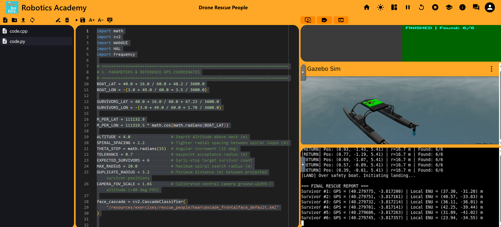

# HAL-Based Implementation: Rescue People

This document details the autonomous navigation, coordinate transformation, and computer vision pipeline implemented using JdeRobot's **Hardware Abstraction Layer (`HAL`)** and **`WebGUI`** APIs to solve the *Rescue People* challenge.

## 1. System Architecture & State Machine

To ensure predictable, modular behavior and clear terminal telemetry during execution, the mission logic is structured as a deterministic **Finite State Machine (FSM)** running inside the `Frequency.tick()` control loop:

1. **`TAKEOFF`:** Records the initial boat deck coordinates $(X_{\text{start}}, Y_{\text{start}}, Z_{\text{start}})$ and commands the quadrotor to ascend to $4.0\text{ m}$ above deck ($Z_{\text{target}} = Z_{\text{start}} + 4.0\text{ m}$) using `HAL.takeoff(target_alt)`.

2. **`GO_TO_ZONE`:** Navigates in a straight line at constant altitude and fixed heading ($\text{yaw} = 0.0\text{ rad}$) toward the estimated midpoint of the survivors using `HAL.set_cmd_pos(x, y, z, az)`.

3. **`SPIRAL`:** Executes a tight outward **Archimedean Spiral** around the survivors' midpoint while continuously analyzing frames from the ventral camera (`HAL.get_ventral_image()`).

4. **`RETURN`:** Triggered automatically once all $6$ expected victims are found or the maximum search radius is reached, commanding the drone back to $(X_{\text{start}}, Y_{\text{start}})$.

5. **`LANDING`:** Initiates descent onto the safety boat deck via `HAL.land()` and monitors vertical altitude until touchdown ($Z_c \le Z_{\text{start}} + 0.25\text{ m}$).

6. **`FINISHED`:** Prints the final deduplicated rescue report containing both global GPS and local metric coordinates for all located survivors.

## 2. Coordinate Frame Transformation (GPS $\leftrightarrow$ Local ENU & Camera Projection)

The `HAL.set_cmd_pos(x, y, z, az)` API operates in a local metric **ENU (East-North-Up)** Cartesian frame relative to the simulation world origin, where $+X$ points **East**, $+Y$ points **North**, and $+Z$ points **Up**.

Given the reference GPS coordinates in Degrees, Minutes, and Seconds (DMS):

* **Safety Boat (Takeoff Origin):** $40^\circ 16' 48.2''\text{ N},\; 3^\circ 49' 03.5''\text{ W}$

* **Estimated Survivors Midpoint:** $40^\circ 16' 47.23''\text{ N},\; 3^\circ 49' 01.78''\text{ W}$

First, DMS values are converted to signed decimal degrees ($\text{lat}, \text{lon}$). Because the operational area spans less than $100\text{ m}$, a local tangent-plane metric projection provides sub-centimeter accuracy relative to full ellipsoidal UTM:

$$
M_{\text{lat}} = 111\,132.9\text{ m/deg}, \qquad M_{\text{lon}} = 111\,319.5 \cdot \cos(\text{lat}_{\text{boat}})\text{ m/deg}
$$

The relative displacement vector from the safety boat to the search center is computed as:

$$
\Delta X_{\text{ENU}} = (\text{lon}_{\text{survivors}} - \text{lon}_{\text{boat}}) \cdot M_{\text{lon}} \approx +40.63\text{ m (East)}
$$

$$
\Delta Y_{\text{ENU}} = (\text{lat}_{\text{survivors}} - \text{lat}_{\text{boat}}) \cdot M_{\text{lat}} \approx -29.93\text{ m (South)}
$$

### Pixel-to-Water Surface Projection

Rather than recording the drone's own center coordinates $(X_c, Y_c)$ when a face is spotted off-center in the camera frame, each detection's pixel offset $(\Delta u_{\text{rot}}, \Delta v_{\text{rot}})$ in the rotated image is inverse-rotated back to the original camera frame $(\Delta u, \Delta v)$ and projected onto the water surface using the calibrated field-of-view scale ($s_{\text{FOV}} = 1.65$ for an $\approx 80^\circ$ FOV):

$$
s_{\text{px}} = \frac{\max(Z_c, 1.0) \cdot s_{\text{FOV}}}{W_{\text{img}}}
$$

$$
X_{\text{face}} = X_c - \Delta v \cdot s_{\text{px}}, \qquad Y_{\text{face}} = Y_c - \Delta u \cdot s_{\text{px}}
$$

Finally, the inverse tangent-plane transformation recovers each survivor's global GPS coordinates for the final report:

$$
\text{lat}_{\text{victim}} = \text{lat}_{\text{boat}} + \frac{Y_{\text{face}} - Y_{\text{start}}}{M_{\text{lat}}}, \qquad \text{lon}_{\text{victim}} = \text{lon}_{\text{boat}} + \frac{X_{\text{face}} - X_{\text{start}}}{M_{\text{lon}}}
$$

## 3. Area Coverage: Tight Archimedean Spiral

Once the drone reaches the estimated midpoint $(X_{\text{center}}, Y_{\text{center}})$, it systematically sweeps the surrounding water using a tight **Archimedean Spiral**, whose polar radius $r$ grows linearly with the swept angle $\theta$:

$$
r(\theta) = a + b\theta = b' \cdot \frac{\theta}{2\pi}
$$

where:

* $a = 0\text{ m}$ (starting at the search midpoint),

* $b' = 2.2\text{ m}$ (tightened from $3.5\text{ m}$ in the initial version) is the radial spacing between consecutive loops, ensuring generous visual overlap between adjacent passes so no peripheral survivor is skipped,

* $\theta$ starts at $\theta_0 = 15^\circ$ and increments by $\Delta\theta = 15^\circ$ whenever the drone enters within `TOLERANCE` ($0.7\text{ m}$) of the active waypoint.

At each step, polar coordinates $(r, \theta)$ are projected back into local ENU waypoints:

$$
\Delta X = r \cos(\theta), \qquad \Delta Y = r \sin(\theta)
$$

$$
X_{\text{new}} = X_{\text{center}} + \Delta X, \qquad Y_{\text{new}} = Y_{\text{center}} + \Delta Y
$$

To prevent unbounded exploration over open water, the spiral terminates immediately when all $6$ expected targets are registered (`EXPECTED_SURVIVORS = 6`) or when the radial distance exceeds `MAX_RADIUS = 20.0 m`.

## 4. Computer Vision & Face Recognition Techniques

Real-time victim detection is performed on the ventral camera feed (`HAL.get_ventral_image()`) using OpenCV's **Viola-Jones Haar Cascade** classifier (`haarcascade_frontalface_default.xml`):

1. **Multi-Orientation Rotation Search ($8$ Angles):**
   Standard frontal Haar Cascades fail when a face is tilted more than $\approx 25^\circ$. Because floating survivors lie in arbitrary orientations in the water while the drone flies in *Heads-Free* mode ($\text{yaw} = 0.0\text{ rad}$), every grayscale frame is evaluated across $8$ discrete orientations:

$$
\alpha \in \{0^\circ, 90^\circ, 180^\circ, 270^\circ, 45^\circ, 135^\circ, 225^\circ, 315^\circ\}
$$

As soon as a face is detected at angle $\alpha$, bounding boxes are drawn on the rotated frame and the search short-circuits to preserve real-time frame rates.

2. **Wave & Sun-Glint False-Positive Suppression:**
   Applying global histogram equalization (`cv2.equalizeHist`) was discarded during testing because it amplified contrast on ocean wave crests, causing false-positive detections. Operating directly on raw grayscale intensity with `minNeighbors=5` and `minSize=(22, 22)` effectively rejects water reflections while maintaining high recall on human faces.

3. **Eliminating Duplicate Detections via Ground Projection (`DUPLICATE_RADIUS`):**
   In the initial version that stored and compared the drone's own position $(X_c, Y_c)$ with `DUPLICATE_RADIUS = 2.5 m`, the same survivor could be counted twice—once when entering the top edge of the camera's field of view and again when exiting the bottom edge (spanning $\approx 2.6\text{ m}$ of drone travel)—while overly restricting the active frame crop caused nearby lateral victims to be missed.
   By keeping the inner $84\%$ of the frame ($[0.08, 0.92]$ of width and height) and projecting each face's pixel offset onto the water surface, repeated sightings of the same person map to the same physical coordinate within $\approx 0.3\text{ m}$. Comparing candidate coordinates against previously stored victims using:

$$
d_i = \sqrt{(X_{\text{face}} - X_i)^2 + (Y_{\text{face}} - Y_i)^2} \ge 3.2\text{ m}
$$

eliminates duplicate counts while accurately distinguishing all $6$ survivors.

4. **Dual-Panel WebGUI Telemetry:**

   * **Right Panel (`WebGUI.showImage`):** Streams the live RGB feed annotated with current FSM state, survivor counter (`Found: X/6`), and green bounding boxes around detected faces.

   * **Left Panel (`WebGUI.showLeftImage`):** Streams the grayscale inspection frame evaluated by the cascade classifier.

## 5. Flight & Perception Parameters (Initial vs. Final Comparison)

The table below preserves the baseline values from the **Initial Version** alongside the calibrated **Final Version** to illustrate how tightening the spiral geometry and switching from drone-center logging to water-surface projection improved coverage and eliminated duplicate detections:

| Parameter | Initial Version (Baseline) | Final Version (Calibrated) | Purpose & Comparative Impact |
| :--- | :--- | :--- | :--- |
| `ALTITUDE` | $4.0\text{ m}$ | $4.0\text{ m}$ | Search height above the boat deck balancing ground coverage and facial resolution. |
| `SPIRAL_SPACING` ($b'$) | $3.5\text{ m}$ | $2.2\text{ m}$ | Tighter radial spacing between spiral turns guarantees visual overlap so no survivor is skipped. |
| `THETA_STEP` ($\Delta\theta$) | $20^\circ$ ($0.349\text{ rad}$) | $15^\circ$ ($0.262\text{ rad}$) | Smaller angular step produces smoother, tightly curved turns around the search center. |
| `TOLERANCE` | $1.0\text{ m}$ | $0.7\text{ m}$ | Tighter waypoint acceptance radius ensures the drone follows close spiral loops without cutting corners. |
| `MAX_RADIUS` | $25.0\text{ m}$ | $20.0\text{ m}$ | Maximum spiral search radius before aborting and returning to the safety boat. |
| `EXPECTED_SURVIVORS` | $6$ | $6$ | Target survivor count triggering early return once all victims are located. |
| `DUPLICATE_RADIUS` | $2.5\text{ m}$ (drone center) | $3.2\text{ m}$ (projected face) | Minimum separation distance; measuring between projected water coordinates prevents counting the same face twice. |
| `CAMERA_FOV_SCALE` | Not used ($0.0$) | $1.65$ ($\approx 80^\circ$ FOV) | Calibrated ground-width-to-altitude ratio used to project pixel offsets onto the water surface. |
| `scaleFactor` | $1.1$ | $1.1$ | Image pyramid scaling step in `detectMultiScale`. |
| `minNeighbors` | $5$ | $5$ | Minimum overlapping candidate rectangles required to confirm a face and reject wave noise. |
| `minSize` | $(22, 22)\text{ px}$ | $(22, 22)\text{ px}$ | Minimum bounding-box size in pixels to filter distant reflections. |

## 6. Experimental Results & Version Comparison

| Evaluation Metric | Initial Version (Drone-Center Logging) | Final Version (Water-Surface Projection) |
| :--- | :--- | :--- |
| **Position Reference** | Raw drone coordinates $(X_c, Y_c)$ | Projected face coordinates $(X_{\text{face}}, Y_{\text{face}})$ on water |
| **Duplicate Detections** | Possible when a face crossed from top to bottom edge ($\approx 2.61\text{ m} > 2.5\text{ m}$) | Eliminated (same face maps within $\approx 0.33\text{ m} \ll 3.2\text{ m}$) |
| **Spiral Coverage** | Wider loops ($b' = 3.5\text{ m}$), could miss peripheral victims | Tight overlapping loops ($b' = 2.2\text{ m}$), full area coverage |
| **Detected Survivors** | At least $5/6$ (prone to early stop if one face was counted twice) | **All $6/6$ unique survivors** located with accurate GPS coordinates |

* **Accurate Boat Deck Touchdown & Reporting:** Recording the initial deck elevation ($Z_{\text{start}}$) at startup ensures touchdown is accurately detected when $Z_c \le Z_{\text{start}} + 0.25\text{ m}$, immediately printing the final rescue report with both decimal GPS coordinates and local ENU coordinates for all $6$ victims.

### Visual & Video Demonstration

Figure 1: Successful mission completion in the HAL-based implementation (FINISHED | Found: 6/6), showing the quadrotor safely landed back on the safety boat deck and the final rescue report printed in the console.

* **Full Execution Video Demonstration:** [Watch Video on Google Drive (All 6/6 Faces Detected & Safe Return)](https://drive.google.com/file/d/1Sq_tSTiu0yIX2BIe87TQG6aR855z4k1N/view?usp=drive_link) — *Demonstrates the complete autonomous flight, the tight Archimedean spiral sweep, real-time detection of all six floating survivors without duplicates, and the final landing on the boat.*
---
