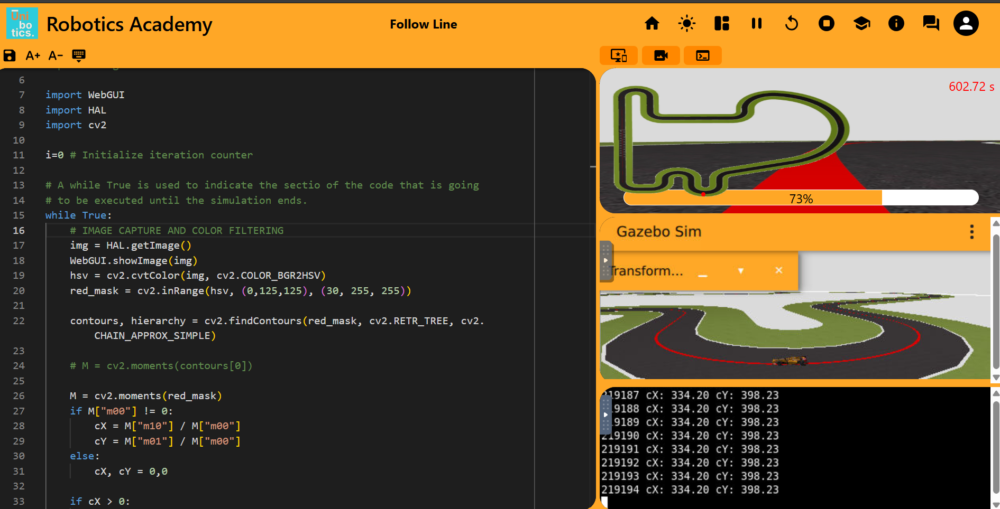
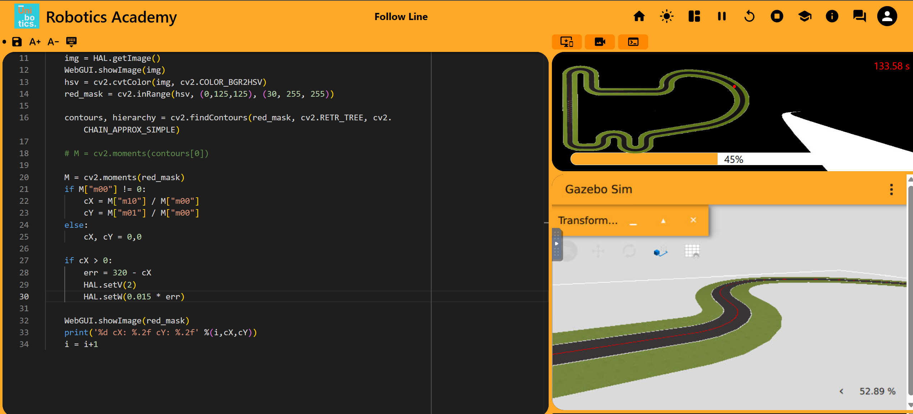
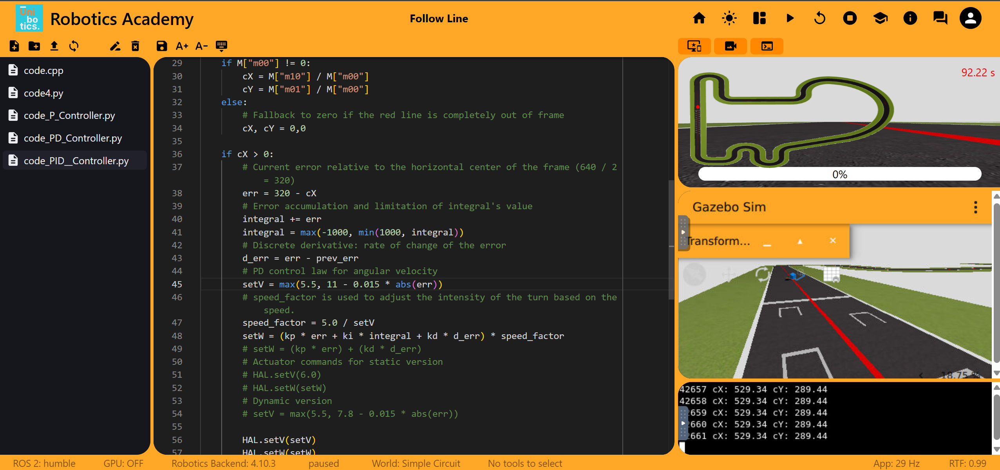
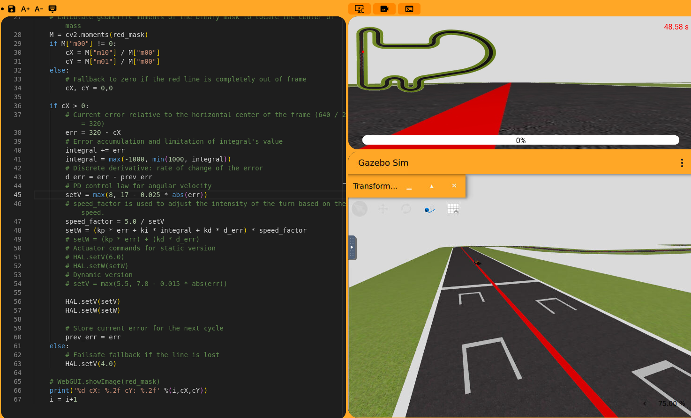

# Autonomous Racing Challenge: Visual Follow Line
**Course ID / Project:** SJK001-7

## Prerequisites and Setup

Before executing the solution, several setup steps were required to configure the development environment:

1. **Unibotics Account:** Created an account on [Unibotics](https://unibotics.org), the platform hosting the virtual robotics simulation environment.
2. **Browser Permissions:** Following the course instructions, configured Google Chrome to **allow insecure content** for `unibotics.org`. This permission is required for the web interface to display the Docker container's console and the simulation viewer.

### Running the Docker Backend

On my personal computer, the simulation environment was deployed locally using the standard CPU-only Docker container. Later, the final code was also tested on the laboratory computers using GPU acceleration to see how fast the car could go with higher frame rates.

Pull the latest robotics backend image:
```bash
docker pull jderobot/robotics-backend:latest
```

Launch the container and expose the necessary ports for the web GUI and simulation communication:
```bash
docker run --rm -it -p 6080-6090:6080-6090 -p 7163:7163 jderobot/robotics-backend:latest
```
With graphic acceleration
```bash
docker run --rm -it --device /dev/dri \
  -p 6080-6090:6080-6090 -p 7163:7163 jderobot/robotics-backend:latest
```
---

## Solution Overview

### Algorithm & Image Processing
The vehicle follows the circuit line using standard computer vision techniques provided by OpenCV:
1. **Frame Acquisition:** Captures the camera stream using `HAL.getImage()`.
2. **Color Filtering (HSV Space):** Converts the image from BGR to HSV and isolates the red track line using `cv2.inRange(hsv, (0, 125, 125), (30, 255, 255))`.
3. **Centroid Detection:** Computes the geometric image moments (`cv2.moments`) over the binary mask to extract the horizontal center of mass ($c_X$).

---

## 1. Proportional (P) Controller (Baseline)

The initial version of the implementation is based on the reference code provided in the virtual classroom. A **Proportional (P) Controller** is the most straightforward approach to tackle the line-following task:

### Control Law & Operating Principle
- **Error Formulation:** Computed as the difference between the **Set Point** (the horizontal center of the $640\text{ px}$ camera frame, $x = 320\text{ px}$) and the **Current Output** (the detected horizontal centroid $c_X$):
  $$e(t) = 320 - c_X$$
- **Actuation:**
  * **Linear velocity ($v$):** Constant value (starting at $v = 1.0\text{ m/s}$ in the baseline).
  * **Angular velocity ($\omega$):** Proportional to the error:
    $$\omega = K_p \cdot e(t)$$
- **Tuning:** The proportional gain $K_p$ is tuned empirically to strike a balance between aggressive steering (which triggers unstable oscillations) and sluggish responses (which lead to understeering in sharp turns).

### Performance & Evaluation
- **Strengths:**
  * **Robust Detection:** The HSV segmentation and image moment calculation consistently detect and trace the red line across the entire circuit.
  * **Reliable Tracking at Low Speeds:** The vehicle successfully completes full laps of the circuit without derailing.
- **Limitations:**
  * **Speed Limit in Sharp Turns:** While the linear speed can be increased up to 5.7 m/s on this track, pushing it higher (e.g., 6.0 m/s) causes the car to overshoot sharp corners and lose the line because it lacks derivative damping.


*Figure 1: Vehicle tracking the red line using the baseline Proportional controller.*

### Experimental Results: P Controller (CPU Version)

| `setV` (m/s) | `setW` (rad/s) | Lap Time | Result / Notes |
| :---: | :---: | :---: | :--- |
| 1.0 | $0.010 \cdot err$ | 816 s | Completed lap. Very stable, but slow speed. |
| 2.0 | $0.010 \cdot err$ | 329 s | Base speed increase without modifying angular gain. Completes the circuit faster. |
| 2.0 | $0.015 \cdot err$ | 321 s | $K_p$ adjustment to improve cornering at higher linear velocity. |
| 4.0 | $0.015 \cdot err$ | 172 s | Moderate speed with noticeable straight-line oscillation. |
| 4.0 | $0.020 \cdot err$ | 175 s | Increased responsiveness in sharp turns, but slower overall time due to higher oscillation. |
| 5.7 | $0.015 \cdot err$ | **125.78 s** | **Best P-Controller lap time** (reproduced consistently on both personal and laboratory computers). |
| 6.0 | $0.020 \cdot err$ | No time | Failed to complete the lap when attempting to increase `setV` to $6.0\text{ m/s}$. |

### Conclusions for Proportional (P) Controller

Based on the experimental results shown in the table above, the proportional controller works well as a starting point, but it has some clear limitations:

- **Zig-Zag Movement:** Increasing the steering gain to improve cornering at higher speeds causes the car to oscillate from side to side around the center of the track. For example, at `setV = 4.0 m/s`, increasing `Kp` from `0.015` to `0.020` slowed the lap time down from `172 s` to `175 s`, as the vehicle wasted distance making excessive steering corrections instead of following a smooth path.
- **Maximum Speed Limit:** At `setV = 6.0 m/s`, the vehicle cannot complete the lap. At this speed, camera processing delay and the lack of derivative braking cause the car to overshoot sharp turns and lose sight of the red line completely.
- **Controller Trade-offs:** A pure P controller struggles to balance high-speed stability with sharp-turn responsiveness. Adding a derivative term and adapting the speed dynamically to the curves are necessary next steps to improve performance.


*Figure 2: Vehicle tracking the red line using the Proportional controller, exhibiting noticeable oscillatory (zig-zag) behavior.*

---

## 2. Proportional-Derivative (PD) Controller

A **PD controller** adds a derivative action to anticipate how the error is changing, helping the car steer more smoothly and avoid overcorrecting at higher speeds.

### How It Works & Code Improvements

- **Proportional (P):** Reacts to the current distance between the car and the center of the track (`err = 320 - cX`).
- **Derivative (D):** Evaluates how quickly the error changes between camera frames, acting like a brake on sudden steering movements:
  * **Δerr = err(t) − err(t−1)**
- **Dynamic Speed Adjustment:** Instead of driving at a constant speed, the linear velocity adjusts automatically based on how far the car is from the center of the line:
  * **setV = max(V_min, V_max − kv × |err|)**
  * This allows the car to accelerate on straight sections (where `err` is close to `0`) and slow down automatically when entering curves.
- **Speed-Based Steering Adjustment (`speed_factor`):** At high speeds, sharp steering commands can make the car unstable. To prevent this, the steering output is scaled down as the speed increases:
  * **speed_factor = 5.0 / setV**
  * **setW = ((Kp × err) + (Kd × Δerr)) × speed_factor**
- **Line-Loss Safety Fallback:** If the car temporarily loses sight of the red line in a sharp corner (`cX = 0`), a safety rule lowers the speed to `setV = 3.0 m/s` so the vehicle slows down and finds the track again.

### Performance & Evaluation

- **Strengths:**
  * **Reduced Zig-Zagging:** The derivative term softens steering corrections on straight sections and when exiting curves.
  * **Higher Top Speeds:** Combined with dynamic speed adjustment and `speed_factor` scaling, the car can reach up to `11.0 m/s` on straightaways.
- **Limitations:**
  * **Sensitivity to Camera Noise:** Sudden jumps in the detected track center (`cX`) can cause abrupt steering reactions from the derivative term.
  * **More Tuning Required:** Both `Kp` and `Kd`, along with the minimum and maximum speed limits, have to be adjusted together to find a good balance between speed and stability.

### Experimental Results: PD Controller (CPU Version)

| `setV` (m/s) | $K_p$ | $K_d$ | Lap Time | Result / Notes |
| :--- | :---: | :---: | :---: | :--- |
| 4.0 (Constant) | 0.015 | 0.008 | 178 s | Baseline PD test; residual zig-zag still persists. |
| 4.0 (Constant) | 0.012 | 0.015 | 168 s | Reduced $K_p$ and increased damping ($K_d$) eliminated zig-zagging on straight lines. |
| 4.0 (Constant) | 0.012 | 0.020 | 166 s | Smoother trajectory with visibly reduced zig-zag in curves. Completed lap 2 s faster due to minimized lateral deviation. |
| 5.0 (Constant) | 0.015 | 0.018 | 139 s | Notable lap time reduction. Mild oscillations remain, but the derivative term provides enough stability for corners at $5.0\text{ m/s}$. |
| Dynamic (5.0 to 6.8) | 0.010 | 0.016 | 131 s | High stability with negligible oscillations. Adaptive speed negotiates corners at $5.0\text{ m/s}$ and exploits straightaways up to $6.8\text{ m/s}$. |
| Dynamic (5.5 to 7.8) | 0.012 | 0.018 | 126 s | Raising the cornering floor to $5.5\text{ m/s}$ and straightaway peak to $7.8\text{ m/s}$ shaved off 5 seconds while preserving damping stability. |
| Dynamic (5.5 to 8.7) | 0.012 | 0.035 | 120.2 s | Increased maximum speed to $8.7\text{ m/s}$ and $K_d$ to $0.035$, improving lap time by 5.8 seconds, though mild oscillations returned. |
| Dynamic (5.5 to 11.0) | 0.011 | 0.035 | **92 s** | **Best PD lap time** (verified on both personal and lab CPU setups). Increasing $V_{\max}$ to $11.0\text{ m/s}$ reduced lap time by 28.2 seconds, though at the cost of stronger oscillations at top speed. |

### Conclusions for Proportional-Derivative (PD) Controller

Throughout the experiments, the PD controller proved very effective, offering a good balance between steering responsiveness and stability:

1. **Reducing Oscillations:** Lowering `Kp` prevented the car from overcorrecting at first, while increasing `Kd` smoothed out the steering and eliminated zig-zagging on straight sections.
2. **Dynamic Speed & Steering Scaling:** Adjusting `setV` based on how far the car was from the center—together with `speed_factor` steering adjustment—led to major improvements, cutting lap times from `178 s` down to **`92 s`**.
3. **Speed vs. Stability Trade-off:** Pushing the maximum speed to `11.0 m/s` brought back oscillations on fast sections, showing that even a well-tuned PD controller hits stability limits when camera frame rates and reaction delays come into play at high speeds.
---

## 3. Proportional-Integral-Derivative (PID) Controller

A **PID controller** combines proportional, integral, and derivative actions to keep the car closer to the line during long curves while maintaining smooth steering at high speeds.

### How It Works & Integral Limit Protection

- **Proportional (P):** Reacts to the current distance between the car and the center of the track (`err = 320 - cX`).
- **Integral (I):** Adds up past errors over time to correct persistent deviations from the center of the track:
  * **I = I + err**
- **Integral Windup Limit:** A common issue with PID controllers is *integral windup*, where long curves cause the accumulated error to grow too large, making the car oversteer once the curve ends. To prevent this, a limit was added in the code to keep the integral value between `-1000` and `1000`:
  * **I = max(-1000, min(1000, I))**
- **Derivative (D):** Measures how quickly the error changes (`Δerr = err(t) − err(t−1)`) to prevent sudden steering oscillations.
- **Complete Control Law (High-Speed GPU Configuration):**
  * **setV** = max(8.0, 17.0 − 0.025 × |err|)
  * **speed_factor** = 5.0 / setV
  * **setW** = ((Kp × err) + (Ki × I) + (Kd × Δerr)) × speed_factor
  * *(Includes a safety fallback speed of `setV = 4.0 m/s` if `cX = 0`)*

### Performance & Evaluation

- **Strengths:**
  * **Better Corner Tracking:** Helps the car stay closer to the inside of long curves and straighten out faster onto straight sections.
  * **Controlled Integral Action:** Limiting the accumulated error prevents oversteering when exiting turns, keeping the trajectory predictable.
- **Limitations:**
  * **High Sensitivity to `Ki`:** Even slightly higher integral values (`Ki >= 0.00002`) worsen lap times by introducing slow, side-to-side swaying.
  * **Hardware Speed Dependency:** At very high speeds (up to `17.0 m/s`), the controller depends on faster simulation frame rates (GPU acceleration) to process camera images quickly enough.


*Figure 3: Vehicle tracking the red line using the PID controller with dynamic speed adaptation and anti-windup clamping.*

### Experimental Results: PID Controller (CPU Version, unless indicated)

| Experiment | `setV` (m/s) | $K_p$ | $K_i$ | $K_d$ | Lap Time | Purpose / Notes |
| :--- | :--- | :---: | :---: | :---: | :---: | :--- |
| PD Baseline | Dynamic (5.5 to 11.0) | 0.011 | 0 | 0.035 | 92 s | Reference result using the PD controller. |
| PID Test 1 | Dynamic (5.5 to 11.0) | 0.011 | 0.00001 | 0.035 | 91 s | A small integral contribution slightly reduced oscillations and improved lap time by 1 s. |
| PID Test 2 | Dynamic (5.5 to 11.0) | 0.011 | 0.00002 | 0.035 | 92 s | Increasing integral action did not improve lap time compared with Test 1. |
| PID Test 3 | Dynamic (5.5 to 11.0) | 0.011 | 0.00005 | 0.035 | 93 s | A stronger integral contribution increased lap time, showing negative effects from excessive integral action. |
| PID Test 4 | Dynamic (5.5 to 11.0) | 0.011 | 0.00010 | 0.035 | 93 s | Confirmed performance degradation with a larger integral gain. |
| PID Test 5 (Run 1) | Dynamic (5.5 to 12.0) | 0.011 | 0.00001 | 0.035 | 85 s | With improved stability from $K_i = 0.00001$, maximum speed was raised to $12.0\text{ m/s}$, achieving a faster time. |
| PID Test 5 (Run 2) | Dynamic (5.5 to 12.0) | 0.011 | 0.00001 | 0.035 | 87 s | Second validation run under the same configuration, confirming consistent improvement. |
| PID Test 5 (Avg) | Dynamic (5.5 to 12.0) | 0.011 | 0.00001 | 0.035 | **86 s** | Best average lap time on local CPU ($V_{\max} = 12.0\text{ m/s}$). |
| PID Lab Test (CPU) | Dynamic (5.5 to 11.0) | 0.011 | 0.00001 | 0.035 | 112 s | Executed on the laboratory computer using software (CPU) rendering. |
| PID Lab Test (GPU) | Dynamic (8.0 to 17.0) | 0.015 | 0.00001 | 0.030 | **48.58 s** | **Best overall record.** Executed on the laboratory computer with GPU acceleration. Higher simulation refresh rates made PID benefits much more noticeable: rapid straight-line alignment (reaching $17.0\text{ m/s}$) and sharper, well-corrected cornering trajectories. |


*Figure 4: Result obtained when executing the code developed for the PID version, showing a faster and better result.*

### Conclusions for Proportional-Integral-Derivative (PID) Controller

1. **Fine-Tuning the Integral Gain:** Adding a small, bounded integral component (`Ki = 0.00001`) improved cornering precision compared to the PD controller, reducing the lap time from `92 s` to `91 s` at `V_max = 11.0 m/s` and allowing a top speed increase to `12.0 m/s` that averaged **`86 s`** on CPU. Larger values (`Ki >= 0.00002`) proved counterproductive.
2. **Impact of GPU Acceleration:** Running the simulation with GPU hardware acceleration showed the full potential of the PID controller. Because the control loop processed camera images and updated steering commands much faster, the car handled a significantly higher speed range (`8.0 to 17.0 m/s`), completing the lap in **48.58 seconds**—a **94% reduction** from the initial `816 s` baseline.

---

## 4. Video Demonstrations

Below are the recorded demonstrations of the best-performing configurations for each controller architecture, executed on my personal laptop with the CPU version:

- **Proportional (P) Controller (Best Lap CPU configuration):** [Watch Video Here](https://drive.google.com/file/d/1gb6rf0lg5fscB20teDClB2RMUlYdOXaF/view?usp=sharing)
- **Proportional-Derivative (PD) Controller (Best Lap CPU configuration):** [Watch Video Here](https://drive.google.com/file/d/1qXxmF-Fxeka_33j-yTF0rdP9CEX1lF0W/view?usp=sharing)
- **Proportional-Integral-Derivative (PID) Controller (Best Lap CPU configuration):** [Watch Video Here](https://drive.google.com/file/d/14sYH46qhBCYl0epYZtoR4DE6WoFyrpqF/view?usp=sharing)

>**Note:** Lap times recorded during video capture on CPU can be slightly higher than benchmark runs due to the additional CPU overhead of screen recording, which slightly reduces the simulation frame rate and control loop frequency.
