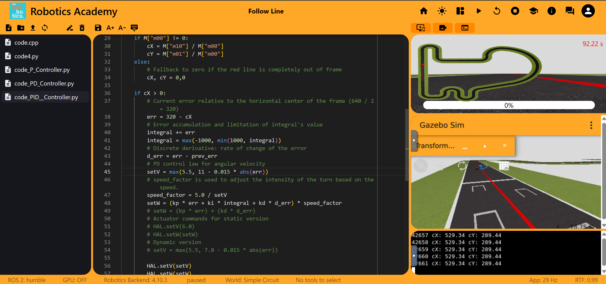

# Autonomous Racing Challenge: Visual Follow Line
**Course ID / Project:** SJK001-7

## Prerequisites and Setup

Before executing the solution, several setup steps were required to configure the development environment:

1. **Unibotics Account:** Created an account on [Unibotics](https://unibotics.org), the platform hosting the virtual robotics simulation environment.
2. **Browser Permissions:** Following the course instructions, configured Google Chrome to **allow insecure content** for `unibotics.org`. This permission is required for the web interface to display the Docker container's console and the simulation viewer.

### Running the Docker Backend

The simulation environment was deployed locally using Docker (configured to run without hardware/GPU acceleration). Additionally, a GPU-enhanced version was used in the laboratory to evaluate maximum performance under higher simulation refresh rates.

Pull the latest robotics backend image:
```bash
docker pull jderobot/robotics-backend:latest
```

Launch the container and expose the necessary ports for the web GUI and simulation communication:
```bash
docker run --rm -it -p 6080-6090:6080-6090 -p 7163:7163 jderobot/robotics-backend:latest
```

---

## Solution Overview

### Algorithm & Image Processing
The vehicle follows the circuit line using standard computer vision techniques provided by OpenCV:
1. **Frame Acquisition:** Captures the camera stream using `HAL.getImage()`.
2. **Color Filtering (HSV Space):** Converts the image from BGR to HSV and isolates the red track line using `cv2.inRange(hsv, (0, 125, 125), (30, 255, 255))`.
3. **Centroid Detection:** Computes the geometric image moments (`cv2.moments`) over the binary mask to extract the horizontal center of mass ($c_X$).

---

## 1. Proportional (P) Controller (Baseline)

The initial version of the implementation is based on the reference code provided in the virtual classroom. A **Proportional (P) Controller** is the most straightforward approach to tackle the line-following task:

### Control Law & Operating Principle
- **Error Formulation:** Computed as the difference between the **Set Point** (the horizontal center of the $640\text{ px}$ camera frame, $x = 320\text{ px}$) and the **Current Output** (the detected horizontal centroid $c_X$):
  $$e(t) = 320 - c_X$$
- **Actuation:**
  * **Linear velocity ($v$):** Constant value (starting at $v = 1.0\text{ m/s}$ in the baseline).
  * **Angular velocity ($\omega$):** Proportional to the error:
    $$\omega = K_p \cdot e(t)$$
- **Tuning:** The proportional gain $K_p$ is tuned empirically to strike a balance between aggressive steering (which triggers unstable oscillations) and sluggish responses (which lead to understeering in sharp turns).

### Performance & Evaluation
- **Strengths:**
  * **Robust Detection:** The HSV segmentation and image moment calculation consistently detect and trace the red line across the entire circuit.
  * **Reliable Tracking at Low Speeds:** The vehicle successfully completes full laps of the circuit without derailing.
- **Limitations:**
  * **Low Speed:** To maintain stability and prevent severe overshoot in sharper turns using only proportional gain, the baseline linear speed is constrained to $v = 1.0\text{ m/s}$, resulting in a slow lap time of $816\text{ s}$.


*Figure 1: Vehicle tracking the red line using the baseline Proportional controller.*

### Experimental Results: P Controller

| `setV` (m/s) | `setW` (rad/s) | Lap Time | Result / Notes |
| :---: | :---: | :---: | :--- |
| 1.0 | $0.010 \cdot err$ | 816 s | Completed lap. Very stable, but slow speed. |
| 2.0 | $0.010 \cdot err$ | 329 s | Base speed increase without modifying angular gain. Completes the circuit faster. |
| 2.0 | $0.015 \cdot err$ | 321 s | $K_p$ adjustment to improve cornering at higher linear velocity. |
| 4.0 | $0.015 \cdot err$ | 172 s | Moderate speed with noticeable straight-line oscillation. |
| 4.0 | $0.020 \cdot err$ | 175 s | Increased responsiveness in sharp turns, but slower overall time due to higher oscillation. |
| 5.7 | $0.015 \cdot err$ | **125.78 s** | **Best P-Controller lap time** (reproduced consistently on both personal and laboratory computers). |
| 6.0 | $0.020 \cdot err$ | No time | Failed to complete the lap when attempting to increase `setV` to $6.0\text{ m/s}$. |

### Conclusions for Proportional (P) Controller

Based on the experimental results shown in the table above, the proportional controller works well as a starting point, but exhibits clear structural limitations:

- **Zig-Zag Movement:** Increasing the steering gain to improve cornering at higher speeds causes the car to oscillate from side to side around the center of the track. For example, at $\text{setV} = 4.0\text{ m/s}$, increasing $K_p$ from $0.015$ to $0.020$ degraded the lap time from $172\text{ s}$ to $175\text{ s}$ because the vehicle spent extra distance making excessive steering corrections rather than following a smooth path.
- **Maximum Speed Limit:** At $\text{setV} = 6.0\text{ m/s}$, the vehicle cannot complete the lap. At this velocity, system latency and lack of predictive damping cause the car to overshoot sharp turns and lose sight of the red line completely.
- **Controller Trade-offs:** A pure P controller struggles to balance high-speed stability and sharp-turn responsiveness. Adding a derivative term and adapting the speed dynamically to the track curvature are necessary next steps.


*Figure 2: Vehicle tracking the red line using the Proportional controller, exhibiting noticeable oscillatory (zig-zag) behavior.*

---

## 2. Proportional-Derivative (PD) Controller

A **PD controller** introduces derivative action to anticipate error changes, helping the car steer more smoothly and avoid overcorrecting at higher speeds.

### How It Works & Code Enhancements

- **Proportional ($P$):** Reacts to the current distance between the car and the center of the track ($e(t) = 320 - c_X$).
- **Derivative ($D$):** Evaluates how quickly the error changes over discrete camera frames, acting as a virtual damper that opposes sudden lateral movements:
  $$\Delta e(t) = e(t) - e(t-1)$$
- **Dynamic Velocity Adaptation:** Instead of driving at a constant speed, linear velocity is adjusted dynamically as a function of the absolute tracking error:
  $$\text{setV} = \max(V_{\min}, V_{\max} - k_v \cdot |e(t)|)$$
  This allows the vehicle to accelerate on straightaways (where $|e(t)| \approx 0$) and automatically decelerate when entering curves.
- **Gain Scheduling (`speed_factor`):** At high speeds, standard angular commands can cause instability. To prevent this, the steering output is scaled inversely with the current speed:

$$\text{speed factor} = \frac{5.0}{\text{setV}}$$

$$\text{setW} = \left(K_p \cdot e(t) + K_d \cdot \Delta e(t)\right) \cdot \text{speed factor}$$
- **Failsafe Recovery:** If the vehicle temporarily loses sight of the line in a tight corner ($c_X = 0$), a fallback routine sets $\text{setV} = 3.0\text{ m/s}$ so the vehicle slows down and safely recovers the track.

### Performance & Evaluation

- **Strengths:**
  * **Reduced Zig-Zagging:** The derivative term dampens oscillations on straight sections and corner exits.
  * **Higher Top Speeds:** Combined with dynamic velocity and `speed_factor` scaling, the vehicle safely reaches up to $11.0\text{ m/s}$ on straightaways.
- **Limitations:**
  * **Sensitivity to High-Frequency Changes:** Abrupt shifts in the detected centroid $c_X$ can cause sharp derivative spikes.
  * **Multi-Parameter Tuning:** Requires simultaneous calibration of $K_p$, $K_d$, and the dynamic velocity bounds.

### Experimental Results: PD Controller

| `setV` (m/s) | $K_p$ | $K_d$ | Lap Time | Result / Notes |
| :--- | :---: | :---: | :---: | :--- |
| 4.0 (Constant) | 0.015 | 0.008 | 178 s | Baseline PD test; residual zig-zag still persists. |
| 4.0 (Constant) | 0.012 | 0.015 | 168 s | Reduced $K_p$ and increased damping ($K_d$) eliminated zig-zagging on straight lines. |
| 4.0 (Constant) | 0.012 | 0.020 | 166 s | Smoother trajectory with visibly reduced zig-zag in curves. Completed lap 2 s faster due to minimized lateral deviation. |
| 5.0 (Constant) | 0.015 | 0.018 | 139 s | Notable lap time reduction. Mild oscillations remain, but the derivative term provides enough stability for corners at $5.0\text{ m/s}$. |
| Dynamic (5.0 to 6.8) | 0.010 | 0.016 | 131 s | High stability with negligible oscillations. Adaptive speed negotiates corners at $5.0\text{ m/s}$ and exploits straightaways up to $6.8\text{ m/s}$. |
| Dynamic (5.5 to 7.8) | 0.012 | 0.018 | 126 s | Raising the cornering floor to $5.5\text{ m/s}$ and straightaway peak to $7.8\text{ m/s}$ shaved off 5 seconds while preserving damping stability. |
| Dynamic (5.5 to 8.7) | 0.012 | 0.035 | 120.2 s | Increased maximum speed to $8.7\text{ m/s}$ and $K_d$ to $0.035$, improving lap time by 5.8 seconds, though mild oscillations returned. |
| Dynamic (5.5 to 11.0) | 0.011 | 0.035 | **92 s** | **Best PD lap time** (verified on both personal and lab CPU setups). Increasing $V_{\max}$ to $11.0\text{ m/s}$ reduced lap time by 28.2 seconds, though at the cost of stronger oscillations at top speed. |

### Conclusions for Proportional-Derivative (PD) Controller

Throughout the experiments, the PD controller proved highly effective, offering a strong balance between steering responsiveness and trajectory stability:

1. **Damping Oscillations:** Lowering $K_p$ limited initial overcorrection, while increasing $K_d$ provided crucial damping that flattened the vehicle's trajectory on straightaways.
2. **Dynamic Speed & Gain Scheduling:** Adjusting `setV` based on tracking error magnitude—paired with `speed_factor` angular scaling—yielded dramatic improvements, cutting lap times from $178\text{ s}$ down to **$92\text{ s}$**.
3. **Stability vs. Speed Trade-off:** Pushing maximum speed to $11.0\text{ m/s}$ reintroduced oscillations on fast sections, showing that even a well-tuned PD controller faces stability limits when frame rates and actuation delays interact at high speeds.

---

## 3. Proportional-Integral-Derivative (PID) Controller

A **PID controller** combines proportional, integral, and derivative control actions to eliminate steady-state tracking offsets during long curves while maintaining high-speed damping.

### How It Works & Anti-Windup Protection

- **Proportional ($P$):** Reacts to the current horizontal error ($e(t) = 320 - c_X$).
- **Integral ($I$):** Accumulates past errors over discrete time steps to correct persistent deviations from the track centerline:
  $$I(t) = I(t-1) + e(t)$$
- **Anti-Windup Clamping:** A common hazard with PID controllers is *integral windup*, where prolonged curves cause the accumulated error to grow excessively, leading to massive overshoot once the curve ends. To prevent this, **explicit clamping** was implemented in the code to bound the integral term within $[-1000, 1000]$:
  $$I(t) = \max(-1000, \min(1000, I(t)))$$
- **Derivative ($D$):** Measures the rate of change of the error ($\Delta e(t) = e(t) - e(t-1)$) to suppress sudden oscillations.
- **Complete Control Law (High-Speed GPU Configuration):**
  * **setV** = max(8.0, 17.0 − 0.025 × |err|)
  * **speed_factor** = 5.0 / setV
  * **setW** = ((Kp × err) + (Ki × I) + (Kd × Δerr)) × speed_factor
  * *(Includes a failsafe velocity of `setV = 4.0 m/s` if `cX = 0`)*

### Performance & Evaluation

- **Strengths:**
  * **Reduced Steady-State Error:** Helps the vehicle stay tighter to the inside of prolonged curves and straighten out faster onto straightaways.
  * **Bounded Integral Action:** The clamping mechanism prevents integral windup, keeping corner exits clean and predictable.
- **Limitations:**
  * **High Sensitivity to $K_i$:** Even slightly excessive integral gains ($K_i \ge 0.00002$) degrade lap times by introducing slow, weaving oscillations.
  * **Hardware Frame-Rate Dependency:** At extreme speeds (up to $17.0\text{ m/s}$), the controller relies on high simulation update rates (GPU acceleration) to sample images fast enough.


*Figure 3: Vehicle tracking the red line using the PID controller with dynamic speed adaptation and anti-windup clamping.*

### Experimental Results: PID Controller

| Experiment | `setV` (m/s) | $K_p$ | $K_i$ | $K_d$ | Lap Time | Purpose / Notes |
| :--- | :--- | :---: | :---: | :---: | :---: | :--- |
| PD Baseline | Dynamic (5.5 to 11.0) | 0.011 | 0 | 0.035 | 92 s | Reference result using the PD controller. |
| PID Test 1 | Dynamic (5.5 to 11.0) | 0.011 | 0.00001 | 0.035 | 91 s | A small integral contribution slightly reduced oscillations and improved lap time by 1 s. |
| PID Test 2 | Dynamic (5.5 to 11.0) | 0.011 | 0.00002 | 0.035 | 92 s | Increasing integral action did not improve lap time compared with Test 1. |
| PID Test 3 | Dynamic (5.5 to 11.0) | 0.011 | 0.00005 | 0.035 | 93 s | A stronger integral contribution increased lap time, showing negative effects from excessive integral action. |
| PID Test 4 | Dynamic (5.5 to 11.0) | 0.011 | 0.00010 | 0.035 | 93 s | Confirmed performance degradation with a larger integral gain. |
| PID Test 5 (Run 1) | Dynamic (5.5 to 12.0) | 0.011 | 0.00001 | 0.035 | 85 s | With improved stability from $K_i = 0.00001$, maximum speed was raised to $12.0\text{ m/s}$, achieving a faster time. |
| PID Test 5 (Run 2) | Dynamic (5.5 to 12.0) | 0.011 | 0.00001 | 0.035 | 87 s | Second validation run under the same configuration, confirming consistent improvement. |
| PID Test 5 (Avg) | Dynamic (5.5 to 12.0) | 0.011 | 0.00001 | 0.035 | **86 s** | Best average lap time on local CPU ($V_{\max} = 12.0\text{ m/s}$). |
| PID Lab Test (CPU) | Dynamic (5.5 to 11.0) | 0.011 | 0.00001 | 0.035 | 112 s | Executed on the laboratory computer using software (CPU) rendering. |
| PID Lab Test (GPU) | Dynamic (8.0 to 17.0) | 0.015 | 0.00001 | 0.030 | **48.58 s** | **Best overall record.** Executed on the laboratory computer with GPU acceleration. Higher simulation refresh rates made PID benefits much more noticeable: rapid straight-line alignment (reaching $17.0\text{ m/s}$) and sharper, well-corrected cornering trajectories. |

### Conclusions for Proportional-Integral-Derivative (PID) Controller

1. **Fine-Tuning the Integral Gain:** Adding a small, clamped integral component ($K_i = 0.00001$) improved cornering precision over the PD baseline, reducing the lap time from $92\text{ s}$ to $91\text{ s}$ at $V_{\max} = 11.0\text{ m/s}$ and allowing a speed increase to $12.0\text{ m/s}$ that achieved an average of **$86\text{ s}$** on CPU. Larger values ($K_i \ge 0.00002$) proved counterproductive.
2. **Impact of GPU Acceleration:** Running the simulation with GPU hardware acceleration revealed the full potential of the PID architecture. Because the control loop received camera frames and applied actuator commands at a higher frequency, the vehicle handled a much more aggressive velocity profile ($\text{setV} \in [8.0, 17.0]\text{ m/s}$), completing the lap in **48.58 seconds**—a **94% reduction** from the initial $816\text{ s}$ baseline.

---

## 4. Video Demonstrations

Below are the recorded demonstrations of the best-performing configurations for each controller architecture, executed in my personal laptop with the CPU version:

- **Proportional (P) Controller (Best Lap CPU configuration):** [Watch Video Here](https://drive.google.com/file/d/1gb6rf0lg5fscB20teDClB2RMUlYdOXaF/view?usp=sharing)
- **Proportional-Derivative (PD) Controller (Best Lap CPU configuration):** [Watch Video Here](https://drive.google.com/file/d/1qXxmF-Fxeka_33j-yTF0rdP9CEX1lF0W/view?usp=sharing)
- **Proportional-Integral-Derivative (PID) Controller (Best Lap CPU configuration):** [Watch Video Here](https://drive.google.com/file/d/14sYH46qhBCYl0epYZtoR4DE6WoFyrpqF/view?usp=sharing)

Note: Lap times recorded during video capture on CPU can be slightly higher than benchmark runs due to the additional CPU overhead of screen recording, which slightly reduces the simulation frame rate and control loop frequency.
