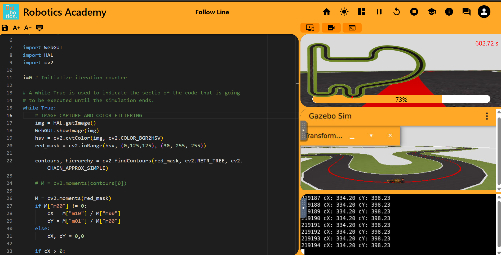

# Autonomous Racing Challenge: Visual Follow Line
**Course ID / Project:** SJK001-7

## Prerequisites and Setup

Before executing the solution, several setup steps were required to configure the development environment:

1. **Unibotics Account:** Created an account on [Unibotics](https://unibotics.org), the platform hosting the virtual robotics simulation environment.
2. **Browser Permissions:** Following the course instructions, configured Google Chrome to **allow insecure content** for `unibotics.org`. This permission is required for the web interface to display the Docker container's console and the simulation viewer.

### Running the Docker Backend

The simulation environment was deployed locally using Docker (configured to run without hardware/GPU acceleration). 

Pull the latest robotics backend image:
```bash
docker pull jderobot/robotics-backend:latest
```
Launch the container and expose the necessary ports for the web GUI and simulation communication:
```bash
docker run --rm -it -p 6080-6090:6080-6090 -p 7163:7163 jderobot/robotics-backend:latest
```

## Solution Overview

### Algorithm & Image Processing
The vehicle follows the circuit line using standard computer vision techniques provided by OpenCV:
1. **Frame Acquisition:** Captures the camera stream using `HAL.getImage()`.
2. **Color Filtering (HSV Space):** Converts the image from BGR to HSV and isolates the red track line using `cv2.inRange()`.
3. **Centroid Detection:** Computes the image moments (`cv2.moments`) over the segmented line to extract the horizontal center coordinate (cX).

### Control Law
The steering is governed by a **Proportional (P) Controller**:
* **Error Formulation:** Computed relative to the image center (320 px for a 640 px frame):
  err = 320 - cX
* **Actuation:**
  * **Linear velocity:** v = 1.0m/s (constant)
  * **Angular velocity:** Ω = K_p * err, with K_p = 0.01

### P Controller Version (Baseline)

The initial version of the implementation is based on the reference code provided in the virtual classroom. 

A **Proportional (P) Controller** is the most straightforward approach to tackle the line-following task:
* **Operating Principle:** It calculates the steering error as the difference between the **Set Point** (the target line position centered in the camera frame, x = 320 px) and the **Current State** (the detected horizontal centroid cX).
* **Tuning:** The proportional gain K_p is tuned empirically to strike a balance between aggressive steering that triggers unstable oscillations and sluggish responses that lead to understeering.

#### Performance & Evaluation
* **Strengths:**
  * **Robust Detection:** The HSV segmentation and image moment calculation consistently detect and trace the red line across the circuit.
  * **Reliable Tracking:** The vehicle successfully completes full laps of the circuit without derailing or losing track of the path.
* **Limitations:**
  * **Low Speed:** To maintain stability and prevent severe overshoot in sharper turns using only proportional gain, the linear speed is constrained to v = 1.0m/s, making lap completion quite slow, obtaining a result of doing the circuit around 816 seconds.


*Figure 1: Vehicle tracking the red line using the baseline Proportional controller.*
