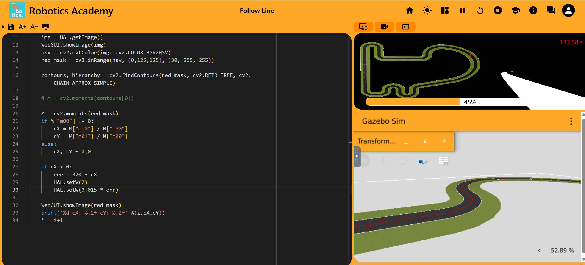

# Autonomous Racing Challenge: Visual Follow Line
**Course ID / Project:** SJK001-7

## Prerequisites and Setup

Before executing the solution, several setup steps were required to configure the development environment:

1. **Unibotics Account:** Created an account on [Unibotics](https://unibotics.org), the platform hosting the virtual robotics simulation environment.
2. **Browser Permissions:** Following the course instructions, configured Google Chrome to **allow insecure content** for `unibotics.org`. This permission is required for the web interface to display the Docker container's console and the simulation viewer.

### Running the Docker Backend

The simulation environment was deployed locally using Docker (configured to run without hardware/GPU acceleration). 

Pull the latest robotics backend image:
```bash
docker pull jderobot/robotics-backend:latest
```
Launch the container and expose the necessary ports for the web GUI and simulation communication:
```bash
docker run --rm -it -p 6080-6090:6080-6090 -p 7163:7163 jderobot/robotics-backend:latest
```

## Solution Overview

### Algorithm & Image Processing
The vehicle follows the circuit line using standard computer vision techniques provided by OpenCV:
1. **Frame Acquisition:** Captures the camera stream using `HAL.getImage()`.
2. **Color Filtering (HSV Space):** Converts the image from BGR to HSV and isolates the red track line using `cv2.inRange()`.
3. **Centroid Detection:** Computes the image moments (`cv2.moments`) over the segmented line to extract the horizontal center coordinate (cX).

### Control Law
The steering is governed by a **Proportional (P) Controller**:
* **Error Formulation:** Computed relative to the image center (320 px for a 640 px frame):
  err = 320 - cX
* **Actuation:**
  * **Linear velocity:** v = 1.0m/s (constant)
  * **Angular velocity:** Ω = K_p * err, with K_p = 0.01

### P Controller Version (Baseline)

The initial version of the implementation is based on the reference code provided in the virtual classroom. 

A **Proportional (P) Controller** is the most straightforward approach to tackle the line-following task:
* **Operating Principle:** It calculates the steering error as the difference between the **Set Point** (the target line position centered in the camera frame, x = 320 px) and the **Current State** (the detected horizontal centroid cX).
* **Tuning:** The proportional gain K_p is tuned empirically to strike a balance between aggressive steering that triggers unstable oscillations and sluggish responses that lead to understeering.

#### Performance & Evaluation
* **Strengths:**
  * **Robust Detection:** The HSV segmentation and image moment calculation consistently detect and trace the red line across the circuit.
  * **Reliable Tracking:** The vehicle successfully completes full laps of the circuit without derailing or losing track of the path.
* **Limitations:**
  * **Low Speed:** To maintain stability and prevent severe overshoot in sharper turns using only proportional gain, the linear speed is constrained to v = 1.0m/s, making lap completion quite slow, obtaining a result of doing the circuit around 816 seconds.


*Figure 1: Vehicle tracking the red line using the baseline Proportional controller.*

### Different versions of Proportional (P) Controller to see different results

| setV | setW | Lap Time | Result / Notes |
| :--- | :--- | :--- | :--- |
| 1 | 0.01 * err | 816 s | Completed lap. Very stable, but slow speed. |
| 2 | 0.01 * err | 329 s | Base speed increase without modifying angular gain. It completes the circuit faster. |
| 2 | 0.015 * err | 321 s | K_p adjustment to improve cornering at higher V. |
| 4 | 0.015 * err | 172 s | Moderate speed with straight-line oscillation. |
| 5.7 | 0.015 * err | 125.78 s | Best lap time registered. |
| 4 | 0.02 * err | 175 s | Increased responsiveness in sharp turns, but worse time than lower setW. |
| 6 | 0.02 * err | no time | Failed to complete the lap when tryin to increase the setV. |

### Conclusions for Proportional (P) Controller

Based on the experimental results shown in the table above, the proportional controller works well as a starting point, but it has some limitations:

**Zig-Zag Movement:** Increasing the steering gain to improve steering at higher speeds can make the car move from side to side around the center of the track. For example, at setV = 4, increasing Kp from 0.015 to 0.020 increased the lap time from 172 s to 175 s. This happens because the car makes too many steering corrections instead of following a smooth path.

**Maximum Speed:** At setV = 6, the car cannot complete the lap. At this speed, the camera and image processing take too long to react to changes, especially in sharp turns. As a result, the car loses sight of the track and cannot continue following it.

**Controller Limitations:** The proportional controller has difficulty balancing speed and stability. Increasing the steering response can make the car less stable, while reducing it can make the car too slow to handle sharp turns. Adding a derivative term or adjusting the speed depending on the track could help improve these results.


*Figure 2: Vehicle tracking the red line using the baseline Proportional controller, exhibiting noticeable oscillatory (zig-zag) behavior.*

## Proportional-Derivative (PD) Controller

A **PD controller** helps the car steer more smoothly and avoid overcorrecting.

### How It Works

- **Proportional (P):** Reacts to the distance between the car and the center of the track (`err = 320 - cX`).
- **Derivative (D):** Looks at how quickly this error changes. It helps adjust the steering to prevent the car from turning too far.

Since the camera captures images at separate time intervals, the change in error is calculated by comparing the current error with the previous one:

**Δerr = err(t) − err(t−1)**

The steering output is calculated as:

**W = (Kp × err) + (Kd × Δerr)**

#### Performance & Evaluation

* **Strengths:**
  
  * **Less zig-zagging:** Reduces constant steering corrections and helps the car follow a smoother path.
  * **Higher speeds:** May allow the car to drive faster than `1.0 m/s` while maintaining a stable trajectory, even in sharp turns.
  
* **Limitations:**
  * **Camera noise:** Sudden changes in the detected track center can cause small, unwanted steering movements.
  * **More tuning:** Both `K_p` and `K_d` need to be adjusted to find a good balance between steering speed and stability.

### Different versions of Proportional Derivative (PD) Controller to see different results

| setV | K_p | K_d | Lap Time | Result / Notes |
| :--- | :--- | :--- | :--- | :--- |
| 4.0 | 0.015 | 0.008 | 178 s | Baseline PD test, residual zig-zag still persists. |
| 4.0 | 0.012 | 0.015 | 168 s | Reduced proportional gain and increased damping to flatten straight lines, in a way that the zig-zag effect disappears in straight lines. |
| 4.0 | 0.012 | 0.020 | 166 s | Smoother trajectory with visibly reduced zig-zag in curves. Completed lap 2-6 seconds faster due to minimized lateral deviation. |
| 5.0 | 0.015 | 0.018 | 139 s | Notable lap time reduction. Although mild oscillations remain, the derivative term provides sufficient stability to negotiate corners at higher speeds. |
| Dynamic (5.0 to 6.8) | 0.010 | 0.016 | 131 s | High stability with negligible oscillations. Adaptive speed reliably negotiates corners at 5.0 m/s while exploiting straightaways up to 6.8 m/s. |
