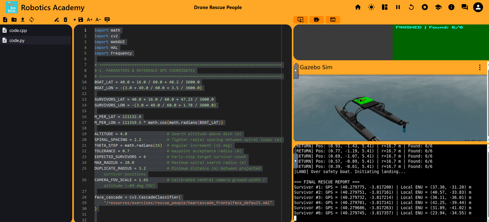

# HAL-Based Implementation: Rescue People

This document details the autonomous navigation, coordinate transformation, and computer vision pipeline implemented using JdeRobot's **Hardware Abstraction Layer (`HAL`)** and **`WebGUI`** APIs to solve the *Rescue People* challenge across three progressive versions:

1. **`code_ver_repeatedFaces.py` (v1 — Baseline Position Control):** Initial prototype using `HAL.set_cmd_pos()` and raw drone-center logging.
2. **`HAL_implementation_slow_speed.py` (v2 — Calibrated Water-Surface Projection):** Tightened spiral geometry with camera-to-water projection to eliminate duplicate detections.
3. **`HAL_implementation_high_speed.py` (v3 — Hybrid Velocity + Position Control):** High-speed ENU-to-body velocity navigation (`HAL.set_cmd_vel()`) with a damped position-hold handoff (`ALIGN_BOAT`) for rapid mission execution and precise deck landing.

---

## 1. System Architecture & State Machine

To ensure predictable, modular behavior and clear terminal telemetry during execution, the mission logic is structured as a deterministic **Finite State Machine (FSM)** running inside the `Frequency.tick()` control loop:

1. **`TAKEOFF`:** Records the initial boat deck coordinates $(X_{\text{start}}, Y_{\text{start}}, Z_{\text{start}})$ and commands the quadrotor to ascend to $4.0\text{ m}$ above deck ($Z_{\text{target}} = Z_{\text{start}} + 4.0\text{ m}$) using `HAL.takeoff(target_alt)`.
2. **`GO_TO_ZONE`:** Navigates toward the estimated midpoint of the survivors at constant altitude and fixed heading ($\text{yaw} = 0.0\text{ rad}$)—using `HAL.set_cmd_pos()` in `v1`/`v2` or fast proportional-braking velocity control (`HAL.set_cmd_vel()` up to $5.5\text{ m/s}$) in `v3`.
3. **`SPIRAL`:** Executes an outward **Archimedean Spiral** around the survivors' midpoint while continuously analyzing frames from the ventral camera (`HAL.get_ventral_image()`).
4. **`RETURN`:** Triggered automatically once all $6$ expected victims are found or the maximum search radius is reached, commanding the drone back to $(X_{\text{start}}, Y_{\text{start}})$.
5. **`ALIGN_BOAT` *(v3 Hybrid Controller)*:** Once within `ALIGN_HANDOFF_DIST = 3.0 m` of the safety boat, switches from velocity commands (`HAL.set_cmd_vel()`) back to position hold (`HAL.set_cmd_pos()`) and waits until centered within `LAND_TOLERANCE = 0.55 m` for `STABILIZE_TICKS = 25` ($\approx 0.8\text{ s}$) to eliminate residual momentum before descent.
6. **`LANDING`:** Initiates descent onto the safety boat deck via `HAL.land()` and monitors vertical altitude until touchdown ($Z_c \le Z_{\text{start}} + 0.25\text{ m}$).
7. **`FINISHED`:** Prints the final deduplicated rescue report containing both global GPS and local metric coordinates for all located survivors.

---

## 2. Coordinate Frame Transformations

### GPS $\leftrightarrow$ Local ENU Projection

The `HAL.set_cmd_pos(x, y, z, az)` API operates in a local metric **ENU (East-North-Up)** Cartesian frame relative to the simulation world origin, where $+X$ points **East**, $+Y$ points **North**, and $+Z$ points **Up**.

Given the reference GPS coordinates in Degrees, Minutes, and Seconds (DMS):

- **Safety Boat (Takeoff Origin):** $40^\circ 16' 48.2''\text{ N},\; 3^\circ 49' 03.5''\text{ W}$
- **Estimated Survivors Midpoint:** $40^\circ 16' 47.23''\text{ N},\; 3^\circ 49' 01.78''\text{ W}$

DMS values are converted to signed decimal degrees ($\text{lat}, \text{lon}$). Because the operational area spans less than $100\text{ m}$, a local tangent-plane metric projection provides sub-centimeter accuracy:

$$
M_{\text{lat}} = 111\,132.9\text{ m/deg}, \qquad M_{\text{lon}} = 111\,319.5 \cdot \cos(\text{lat}_{\text{boat}})\text{ m/deg}
$$

The relative displacement vector from the safety boat to the search center is:

$$
\Delta X_{\text{ENU}} = (\text{lon}_{\text{survivors}} - \text{lon}_{\text{boat}}) \cdot M_{\text{lon}} \approx +40.63\text{ m (East)}
$$

$$
\Delta Y_{\text{ENU}} = (\text{lat}_{\text{survivors}} - \text{lat}_{\text{boat}}) \cdot M_{\text{lat}} \approx -29.93\text{ m (South)}
$$

### World ENU to Body-Frame Velocity Control (`v3` — `HAL_implementation_high_speed.py`)

While `HAL.set_cmd_pos()` expects global ENU coordinates, `HAL.set_cmd_vel(vx, vy, vz, az)` expects linear velocities expressed in the quadrotor's **body frame**. In `v3`, the desired horizontal speed vector $(v_{x,\text{world}}, v_{y,\text{world}})$ toward the target $(X_t, Y_t)$ is computed in ENU (with linear deceleration $v = \min(v_{\max}, \max(v_{\min}, k_v \cdot d))$ during transit and return) and rotated into body coordinates using `yaw = HAL.get_yaw()` ($\psi$):

$$
v_{x,\text{body}} = \cos(\psi)\,v_{x,\text{world}} + \sin(\psi)\,v_{y,\text{world}}, \qquad v_{y,\text{body}} = -\sin(\psi)\,v_{x,\text{world}} + \cos(\psi)\,v_{y,\text{world}}
$$

Altitude and heading are stabilized simultaneously via clamped proportional feedback:

$$
v_z = \text{clip}\big(1.5\,(Z_t - Z_c),\; -1.5,\; 1.5\big), \qquad \omega_z = \text{clip}\big(1.5\,\text{atan2}(\sin(-\psi), \cos(-\psi)),\; -1.0,\; 1.0\big)
$$

### Pixel-to-Water Surface Projection (`v2` & `v3`)

Rather than recording the drone's own center coordinates $(X_c, Y_c)$ when a face is spotted off-center in the camera frame (as in `v1`), each detection's pixel offset $(\Delta u_{\text{rot}}, \Delta v_{\text{rot}})$ in the rotated image is inverse-rotated back to the original camera frame $(\Delta u, \Delta v)$ and projected onto the water surface using the calibrated field-of-view scale ($s_{\text{FOV}} = 1.65$ for an $\approx 80^\circ$ FOV):

$$
s_{\text{px}} = \frac{\max(Z_c, 1.0) \cdot s_{\text{FOV}}}{W_{\text{img}}}
$$

$$
X_{\text{face}} = X_c - \Delta v \cdot s_{\text{px}}, \qquad Y_{\text{face}} = Y_c - \Delta u \cdot s_{\text{px}}
$$

Finally, the inverse tangent-plane transformation recovers each survivor's global GPS coordinates for the final report:

$$
\text{lat}_{\text{victim}} = \text{lat}_{\text{boat}} + \frac{Y_{\text{face}} - Y_{\text{start}}}{M_{\text{lat}}}, \qquad \text{lon}_{\text{victim}} = \text{lon}_{\text{boat}} + \frac{X_{\text{face}} - X_{\text{start}}}{M_{\text{lon}}}
$$

---

## 3. Area Coverage: Archimedean Spiral

Once the drone reaches the estimated midpoint $(X_{\text{center}}, Y_{\text{center}})$, it sweeps the surrounding water using an outward **Archimedean Spiral**, whose polar radius $r$ grows linearly with the swept angle $\theta$:

$$
r(\theta) = b' \cdot \frac{\theta}{2\pi}
$$

- **Loop Spacing ($b'$):** Set to $3.5\text{ m}$ in `v1`, tightened to $2.2\text{ m}$ in `v2` (`slow_speed`) for dense position-controlled overlap, and calibrated to $2.8\text{ m}$ in `v3` (`high_speed`) to balance full camera overlap with continuous $2.8\text{ m/s}$ tangential flight.
- **Angular Step & Lookahead:** $\theta$ increments by $\Delta\theta = 15^\circ$ ($20^\circ$ in `v1`). In `v3`, starting at $\theta_0 = 180^\circ$ with a lookahead tolerance of `SPIRAL_TOLERANCE = 1.15 m` lets the drone chain consecutive waypoints smoothly without decelerating at every vertex.

At each step, polar coordinates $(r, \theta)$ are projected into local ENU waypoints:

$$
X_{\text{new}} = X_{\text{center}} + r \cos(\theta), \qquad Y_{\text{new}} = Y_{\text{center}} + r \sin(\theta)
$$

The spiral terminates immediately when all $6$ expected targets are registered (`EXPECTED_SURVIVORS = 6`) or when $r$ exceeds `MAX_RADIUS` ($25.0\text{ m}$ in `v1`, $20.0\text{ m}$ in `v2`/`v3`).

---

## 4. Computer Vision & Face Recognition Techniques

Real-time victim detection is performed on the ventral camera feed (`HAL.get_ventral_image()`) using OpenCV's **Viola-Jones Haar Cascade** classifier (`haarcascade_frontalface_default.xml`):

1. **Multi-Orientation Rotation Search ($8$ Angles):**
   Because floating survivors lie in arbitrary orientations in the water while the drone flies in *Heads-Free* mode ($\text{yaw} = 0.0\text{ rad}$), every grayscale frame is evaluated across $8$ discrete orientations:

$$
\alpha \in \{0^\circ, 90^\circ, 180^\circ, 270^\circ, 45^\circ, 135^\circ, 225^\circ, 315^\circ\}
$$

   As soon as a face is detected at angle $\alpha$, bounding boxes are drawn on the rotated frame and the search short-circuits to preserve real-time frame rates.

2. **Wave & Sun-Glint False-Positive Suppression:**
   Global histogram equalization (`cv2.equalizeHist`) was discarded because it amplified contrast on ocean wave crests. Operating directly on raw grayscale intensity with `scaleFactor=1.1`, `minNeighbors=5`, and `minSize=(22, 22)` effectively rejects water reflections while maintaining high recall on human faces.

3. **Eliminating Duplicate Detections via Ground Projection (`DUPLICATE_RADIUS`):**
   In `v1` (`code_ver_repeatedFaces.py`), storing the drone's own position $(X_c, Y_c)$ with `DUPLICATE_RADIUS = 2.5 m` allowed a survivor crossing from the top to the bottom edge of the camera view ($\approx 2.6\text{ m}$ of drone travel) to be counted twice.
   In `v2` and `v3`, keeping the inner $84\%$ of the frame ($[0.08, 0.92]$ of width and height) and projecting each face's pixel offset onto the water surface maps repeated sightings of the same person to the same physical coordinate within $\approx 0.3\text{ m}$. Comparing candidate coordinates against stored victims via:

$$
d_i = \sqrt{(X_{\text{face}} - X_i)^2 + (Y_{\text{face}} - Y_i)^2} \ge 3.2\text{ m}
$$

   eliminates duplicate counts while distinguishing all $6$ survivors.

4. **Dual-Panel WebGUI Telemetry:**
   - **Right Panel (`WebGUI.showImage`):** Streams the live RGB feed annotated with current FSM state, survivor counter (`Found: X/6`), and green bounding boxes around detected faces.
   - **Left Panel (`WebGUI.showLeftImage`):** Streams the grayscale inspection frame evaluated by the cascade classifier.

---

## 5. Flight & Perception Parameters Across All Three Files

| Parameter | `v1`: `code_ver_repeatedFaces.py` | `v2`: `HAL_implementation_slow_speed.py` | `v3`: `HAL_implementation_high_speed.py` | Purpose & Impact |
| :--- | :---: | :---: | :---: | :--- |
| **Motion API** | `HAL.set_cmd_pos()` | `HAL.set_cmd_pos()` | `HAL.set_cmd_vel()` + `HAL.set_cmd_pos()` | Hybrid velocity cruise + position landing in `v3`. |
| `ALTITUDE` | $4.0\text{ m}$ | $4.0\text{ m}$ | $4.0\text{ m}$ | Search height above the boat deck. |
| `SPIRAL_SPACING` ($b'$) | $3.5\text{ m}$ | $2.2\text{ m}$ | $2.8\text{ m}$ | Radial spacing between consecutive spiral loops. |
| `THETA_STEP` ($\Delta\theta$) | $20^\circ$ ($\theta_0 = 20^\circ$) | $15^\circ$ ($\theta_0 = 15^\circ$) | $15^\circ$ ($\theta_0 = 180^\circ$) | Angular increment per spiral waypoint. |
| `TOLERANCE` | $1.0\text{ m}$ | $0.7\text{ m}$ | `0.7 m` (transit) / `1.15 m` (spiral) | Lookahead radius in `v3` avoids braking between spiral points. |
| `MAX_RADIUS` | $25.0\text{ m}$ | $20.0\text{ m}$ | $20.0\text{ m}$ | Maximum spiral search radius before returning. |
| `DUPLICATE_RADIUS` | $2.5\text{ m}$ (drone center) | $3.2\text{ m}$ (projected face) | $3.2\text{ m}$ (projected face) | Minimum separation between distinct survivors. |
| `CAMERA_FOV_SCALE` | Not used | $1.65$ | $1.65$ | Ground-width-to-altitude scale for pixel projection. |
| **Cruise / Spiral Speeds** | Fixed internal controller | Fixed internal controller | `5.5 m/s` out / `2.8 m/s` spiral & return | Fast transit with controlled search and return speeds. |
| **Landing Alignment** | Direct `HAL.land()` | Direct `HAL.land()` | `ALIGN_BOAT` ($<0.55\text{ m}$ for $25\text{ ticks}$) | Damps horizontal inertia before descending onto the boat. |

---

## 6. Experimental Results & Version Comparison

| Evaluation Metric | `v1`: Baseline (`repeatedFaces`) | `v2`: Calibrated (`slow_speed`) | `v3`: Hybrid Fast (`high_speed`) |
| :--- | :--- | :--- | :--- |
| **Position Reference** | Drone center $(X_c, Y_c)$ | Projected water coordinates $(X_{\text{face}}, Y_{\text{face}})$ | Projected water coordinates $(X_{\text{face}}, Y_{\text{face}})$ |
| **Duplicate Detections** | Possible when crossing frame edges | Eliminated | Eliminated |
| **Detected Survivors** | $\ge 5/6$ (risk of early stop on duplicate) | **$6/6$ unique survivors** | **$6/6$ unique survivors** |
| **Mission Speed & Touchdown** | Moderate speed; direct descent | Slower position-stepped flight; accurate landing | **$\approx 3\times$ faster flight**; stabilized deck touchdown |

### Visual & Video Demonstration

*Figure 1: Successful mission completion in the HAL-based implementation (`FINISHED | Found: 6/6`), showing the quadrotor safely landed back on the safety boat deck and the final rescue report printed in the console.*

- **Full Execution Video Demonstration:** [Watch Video on Google Drive (All 6/6 Faces Detected & Safe Return)](https://drive.google.com/file/d/1Sq_tSTiu0yIX2BIe87TQG6aR855z4k1N/view?usp=drive_link) — *Demonstrates the autonomous flight, Archimedean spiral sweep, real-time detection of all six floating survivors without duplicates, and final landing on the boat.*
